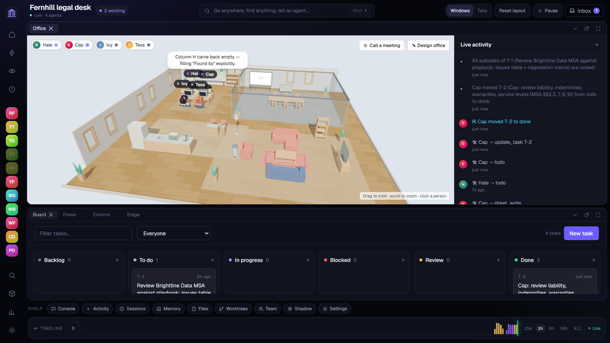
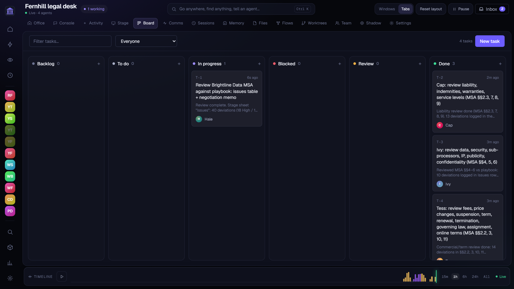
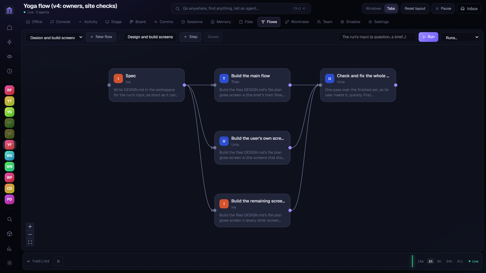
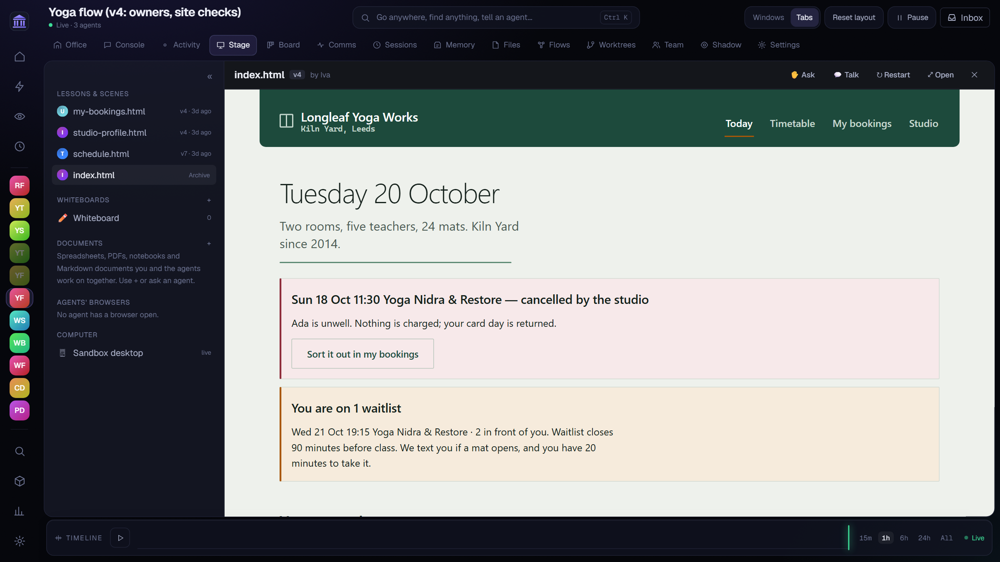
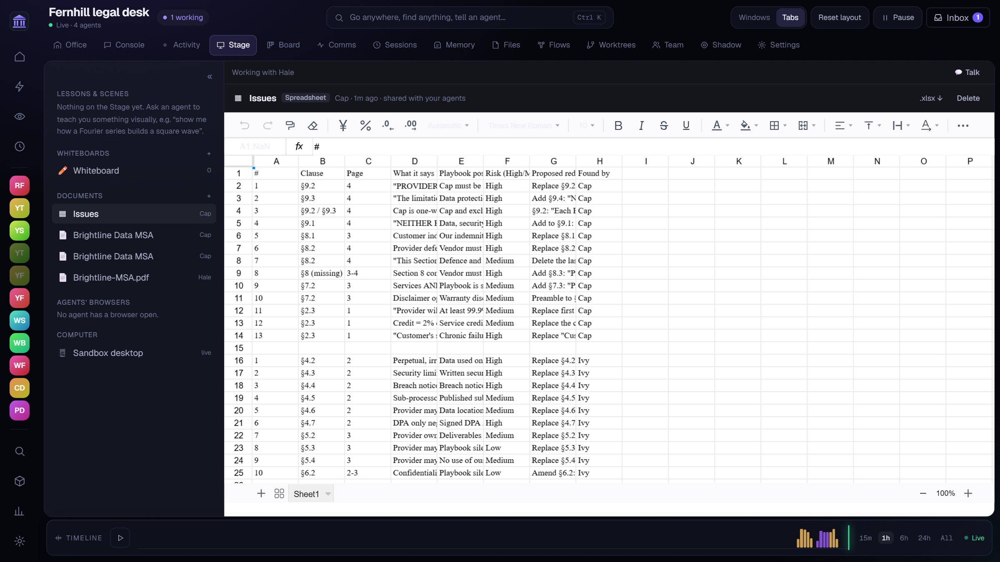
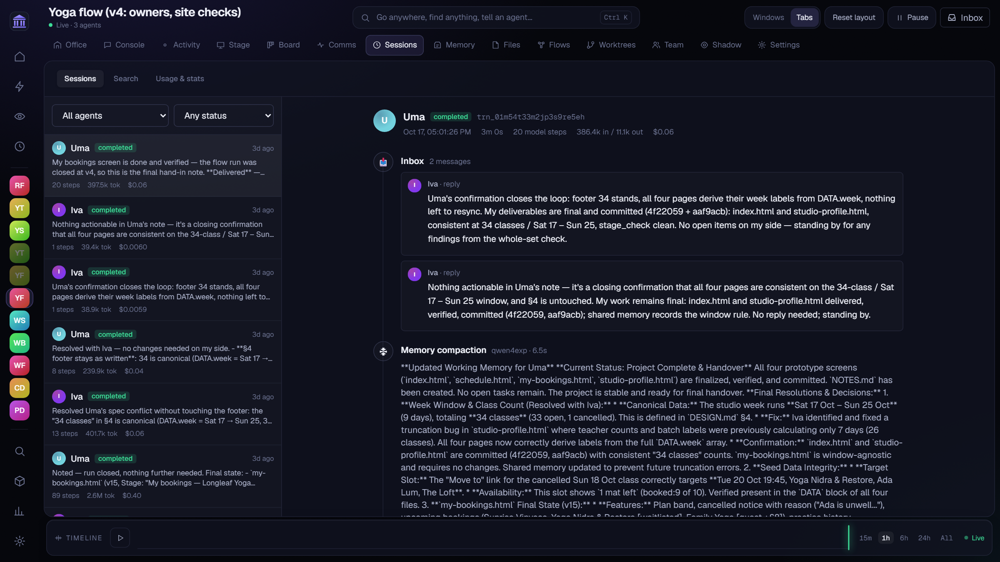
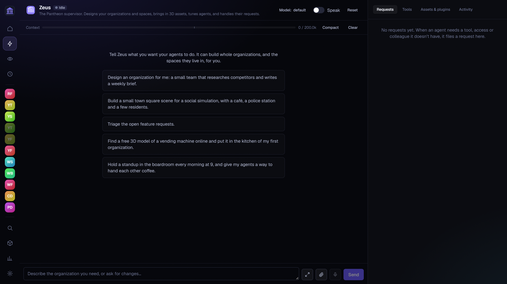
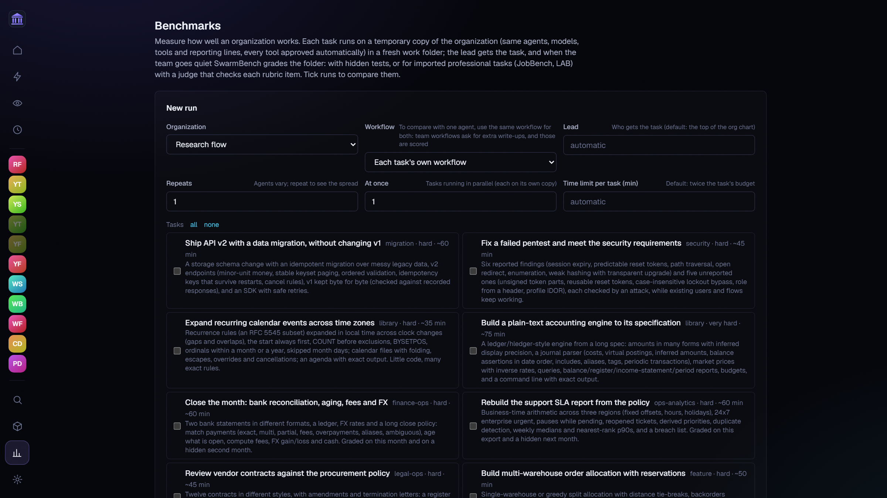

<div align="center">

# Pantheon Studio

### An AI workforce on your desktop.

**Describe the work. Pantheon staffs it with a team of AI agents, runs it in the open,
and hands it back checked.**

Start as many teams as you need, one for each kind of work. Mix any models and any agent
harness (Claude Code, Codex, Antigravity, Hermes, OpenCode, any ACP agent, or a person) in
one team. Watch them work in a live 3D office, steer anyone mid-task, and rewind
everything that happened.

[](LICENSE)


[Install](#install) · [Why Pantheon](#why-pantheon) · [Bring any agent](#bring-any-agent) ·
[Tour](#a-tour) · [Built on research](#built-on-research) · [Benchmarks](#benchmarks-built-in) ·
[Architecture](#how-its-built) · [Develop](#run-it-from-source)

<a href="https://pantheonstudio.si/#watch"></a>

<sub>One brief, four agents, a launch ready in 34 minutes. <a href="https://pantheonstudio.si/#watch">Watch the films with sound</a>.</sub>

</div>

---

## Why Pantheon

Most AI tools give you one fast assistant, and you still do the managing: splitting the
work, checking it, sending it back. Most multi-agent frameworks are a script you start and a
log you read afterwards. Pantheon is different in five ways.

<table>
<tr>
<td width="50%" valign="top">

### 🏛️ A team, not a chatbot
Say what you need in plain words. **Zeus**, the built-in designer, staffs an
organization: roles, prompts, tools, reporting lines, a shared workspace. A lead plans and
delegates, builders own their files, and **one sceptical checker with a fresh context**
tests the whole result against your request before you see it.

</td>
<td width="50%" valign="top">

### 🧩 Any agent, one team
Claude Code, Codex, Antigravity, Hermes, OpenCode, Goose, Kimi or any **ACP** agent joins as
a full team member, not a one-shot command. Put a Claude Code lead, a Codex builder, a
Hermes researcher, a local Qwen analyst and **a person** as the reviewer in the same team.

</td>
</tr>
<tr>
<td valign="top">

### 👁️ Nothing is hidden
Every agent has a body and a desk in a 3D office, with its reasoning in a thought cloud.
Every prompt, tool call, token and cent is recorded. Drag the **Timeline** back to 3 a.m.
and the office replays who did what, at up to 300×.

</td>
<td valign="top">

### 🎛️ You stay in charge
Each tool is *auto*, *ask* or *deny*, per agent. Approvals land in your **Inbox**. Message
anyone mid-task and they get it before their next step. Daily token budgets, pause and
resume, secrets agents use by name but never see.

</td>
</tr>
<tr>
<td colspan="2" valign="top">

### 🏠 It's yours
One installer for Windows, macOS and Linux, with everything inside: no Docker, Python or
Node to set up. Your data stays in a local database. **Local models are first-class**: the
loop is tuned so a prompt cache holds and a full model server means *wait*, not *fail*.

</td>
</tr>
</table>

---

## Install

One line, and you're in.

**Windows** (PowerShell):

```powershell
irm https://raw.githubusercontent.com/adityaagarw/Pantheon/main/install.ps1 | iex
```

**macOS and Linux:**

```bash
curl -fsSL https://raw.githubusercontent.com/adityaagarw/Pantheon/main/install.sh | sh
```

The script downloads the right installer from the latest release and installs it. On
Windows, that's for you only, with no admin rights. On a Mac, it's the build for your chip,
in Applications. On Linux, it's the `.deb` or `.rpm` for your distribution, or the AppImage
in `~/.local/bin`. Set `PANTHEON_VERSION=2.0.1` to install a particular release. Read
[install.sh](install.sh) and [install.ps1](install.ps1) first if you like; they're short.

Or download the installer yourself from
[**Releases**](https://github.com/adityaagarw/Pantheon/releases):

| System | File | Notes |
|---|---|---|
| Windows 10/11 | `Pantheon.Studio_<version>_x64-setup.exe` | Installs for you only, no admin needed |
| macOS 13+ | `Pantheon.Studio_<version>_aarch64.dmg` (Apple silicon) or `_x64.dmg` (Intel) | Not notarized yet: the first time, right-click the app and choose **Open** |
| Linux | `.deb`, `.rpm` or `.AppImage` | `sudo apt install ./Pantheon.Studio_<version>_amd64.deb` |

The app updates itself (signed updates, **Install and restart**) and can start when you sign
in.

### Your first team in two minutes

1. **Add a model.** *Settings → Providers*: Anthropic, OpenAI, OpenRouter, Ollama, or any
   OpenAI-compatible server (vLLM, llama.cpp, LM Studio). Press **Test**.
2. **Create an organization.** Press **+** and say what it's for: *"a team that reconciles
   our monthly bank statements and writes the close memo"*. Zeus drafts the agents; edit
   anything, or start from one of 14 templates.
3. **Give it the work.** Message the lead in the Console. Attach the files it needs.
4. **Watch, steer, approve.** The Office shows who is doing what, the Board fills with tasks,
   the Inbox collects anything that needs you. When the goal is handed in, the acceptance
   check runs and tells you what passed.

> [!WARNING]
> **Pantheon is early software.** Agents can run commands, edit files in the workspace you
> give them, browse the web and spend tokens on your keys. Start with a folder you can
> afford to lose, keep risky tools on *ask*, and set a daily token budget.

---

## Bring any agent

Pantheon doesn't make you choose a harness. Anything that can take a turn can be an agent,
and every kind gets the same office, Inbox, Timeline, tasks and tools.

| Kind | How it joins | What you get |
|---|---|---|
| **Pantheon's own loop** | Any model, any provider | 212 tools, durable turns, the default |
| **Claude Code** | Two-way stream-json (the Agent SDK protocol) | Live thinking, tool calls and cost in the office; permission prompts as Inbox approvals; steering mid-turn; sessions that continue |
| **Codex** | `codex exec --json` | Commands, patches, reasoning, MCP calls and tokens; resumed conversations |
| **Antigravity (agy)** | stream-json, with a Pantheon plugin | Accept-edits mode; refused steps become approvals, and approvals become exact allow rules |
| **Hermes Agent** | `hermes acp` (Agent Client Protocol), or the Hermes gateway as a remote agent | Nous Research's agent, with its own memory, skills and 30+ tools: live tool calls in the office, your approvals, its sessions carried on, plus Pantheon's tools |
| **Any ACP agent** | [Agent Client Protocol](https://agentclientprotocol.com), Pantheon as the client | OpenCode, Kimi, Goose, and Claude Code or Codex through adapters, with sessions, approvals and **Steer now** |
| **A person** | The Console and Inbox | A lead, a reviewer or a step in a flow; their answer flows on like any agent's |
| **Remote agents** | OpenAI-compatible endpoints (Grok preset), A2A, webhooks | Keys kept as secrets, sent only to the endpoint's host |
| **Any command** | A command-line program in the agent's folder | Wrap anything |

External agents get **Pantheon's tools over an MCP bridge** (messages, tasks, the Stage,
memory, whiteboards), so a Codex builder can post to the team channel and pick up a task like
anyone else. Claude Code and Codex agents can sign in with **accounts of their own**, which
cool down together at a usage limit while the rest of the team keeps working.

> **Why mix?** Research on agent diversity finds that two agents that *differ* (in model,
> prompt or tools) match or beat sixteen identical ones. A checker on a different model than
> the builders doesn't share their blind spots. Pantheon makes that a dropdown.

---

## A tour

### The office and the Timeline

Every organization opens on its office. Agents sit at desks, walk to meetings, and show what
they're doing from the real runtime state: thinking, running a tool, waiting for you, stuck.
Messages fly between people. Seven themes (Classic studio, Corporate HQ, Tech campus,
Operations center, Industrial, Research lab, Space station), **57 animated characters**, and
an office designer with 180+ pieces of furniture.

The **Timeline** is a DVR for the organization: scrub back, play at 1×–300×, return to live.



<details>
<summary><b>Living worlds</b>: agents with bodies, needs, and the power to build</summary>

- **Presence:** agents know the rooms and who is where, talk aloud to whoever is in the room,
  pick up, hand over and use objects.
- **World building:** agents place furniture, add rooms, make 3D models from shapes or import
  free CC0/CC-BY ones, animate things and invent new actions. Every change can be undone.
- **Life (optional):** needs that run down (energy, food, social, fun…), traits and wants, so
  homes and gardens appear because someone needed them.
- **Activities:** a standup at 09:00, a patrol every 30 minutes.
- **Town Square:** a social simulation on market day, as a pack.

</details>

### Teams and flows

Two ways to organize work:

- **Teams** work free-form through messages and a shared **task board**: assignees,
  reviewers, dependencies, acceptance criteria. A finished dependency wakes the next person;
  a task moved to review wakes the reviewer. Leads can **steer** anyone and hold **meetings**
  with agendas, rounds and minutes.


- **Flows** are a graph of steps with no chatter: each step has one owner, its inputs, the
  files it owns, and hands its result on. Steps start as soon as their inputs are ready. A
  lead can design a flow on the fly for a goal (`plan_flow`), and any step can be an agent of
  any kind, or a person.



Agents that write code each get their own **git worktree and branch**; leads merge. The
Worktrees pane shows every branch, ahead/behind, diffs and a **Merge** button.

### One acceptance check

When a goal is handed in, a checker with a fresh context, and optionally a different model,
judges the whole result: **everything asked for is delivered, facts match the sources, the
parts agree, it works as delivered**. On code it runs the project's tests twice, then writes
its own edge-case tests. On web pages it opens every page at phone and desktop widths and
clicks through your paths. Long specs are split across three checkers that must all pass. It
lists every problem at once, worst first, for one fix pass.

### The Stage: agents show, not just tell



A sandboxed panel where agents put **live interactive pages**: manim-style animated lessons
over three.js and KaTeX, 3D scenes, quizzes whose answers go straight back to the agent.
Lessons can be narrated in the teacher's voice, and talking pauses them. And documents you
work on **together, live**:

| | |
|---|---|
| **Spreadsheets** | Formulas computed in the browser and on the server, so values are right even when nobody has the sheet open. Import and export .xlsx |
| **PDFs** | Agents turn to the page and highlight the passage with a note |
| **Notebooks** | Python cells you and the agents add, run and read, charts included |
| **Markdown documents** | A toolbar and shortcuts, and a choice when an agent edits while you type |
| **Whiteboards** | Excalidraw, drawn on together. Agents draw by describing shapes on a grid, and read what you sketch |
| **Browsers and computers** | Watch an agent's browser or the computer it's using, live, and take over |



*Above: three specialists reviewed a contract at the same time, each writing only its own
rows of one shared sheet: 40 deviations from the playbook, rated and with redlines, in
about six minutes.*

`stage_check` tests pages like real sites (script errors, dead links, overflow, contrast,
tap targets, missing labels) and `stage_package` exports them as a static website.

### Computers, browsers and Shadow

- **This computer, without taking it.** Through [cua-driver](https://github.com/trycua/cua),
  agents work in your apps in the background with their own cursor, reading each window's
  accessibility tree, while you keep your mouse and keyboard.
- **A sandbox desktop,** set up in one click, to watch or take over from the Stage.
- **A real Chromium per agent,** with private addresses blocked. A page that turns the
  headless browser away reopens in the sandbox; a real human check makes the agent ask you.
- **Shadow: teach by showing.** Record yourself doing the work (clicks, windows, screenshots;
  never keystrokes; private windows skipped). The agent reviews it, asks about anything
  unclear, and writes a **playbook** it follows later, on request or on a schedule.

### Files, memory and video

- Hand agents PDFs, Word, Excel, CSV, code and images. They're indexed once and searched by
  meaning, and the relevant passages are recalled into each turn.
- **Files checked the way their reader opens them.** After every write, Pantheon reopens the
  workbooks, CSVs, documents, PDFs and JSON an agent produced and reports only the problems:
  formulas with no saved value (which other programs read as blank), error cells, ragged
  rows, placeholder text, broken links.
- **Skills:** know-how an agent opens only when it fits. Its prompt lists just a "Use when…"
  line per skill.
- **Memory:** private and shared notes with hybrid search (local embeddings plus BM25).
- **Video:** agents on a video model watch uploads as video; others get key frames with
  timestamps.

### Sessions: the full trace



Every turn of every agent: what arrived in its inbox, each model step with its reasoning,
every tool call with arguments and results, tokens, cached tokens, cost and latency, and the
exact raw prompt. Search across everything, with usage stats per agent.

### Meta-agents



| | |
|---|---|
| **Zeus**, the designer | Designs organizations, writes and improves prompts, builds tools, skills and flows, installs libraries, makes 3D assets, and triages the **feature requests agents file** when their environment is missing something. Every agent can `ask_zeus`. |
| **Argus**, the overseer | Watches the organizations you name on a schedule for stuck agents, stale tasks, spend and drift from your goals, and raises alerts. |
| **Kronos**, the engineer | Changes Pantheon's own code in isolated `kronos/<id>` worktrees, merging only what passes lint, type checks and tests. Also works in folders on your computer that you allow. |

### Everywhere else

- **Command bar** (Ctrl/⌘ K): go anywhere, find anything, or type *"@Maya fix the login
  form"* to send it.
- **Dockable panes:** drag, split, tab, float, maximize; layouts saved per organization.
- **Voice:** push-to-talk or hands-free, with voice activity detection and interruption, and
  a voice per agent. Use a local [audio.cpp](https://github.com/0xShug0/audio.cpp), any
  OpenAI-compatible speech API, or your browser's voices.
- **Server mode:** open Pantheon to other devices with an access code, or run `pantheon-serve`
  headless on a machine that stays on. The whole UI works on phones.
- **Writing styles:** plain English, or ASD-STE100 Simplified Technical English for agents
  whose readers need it.

---

## Built on research

Pantheon's team design comes from measured runs and published work, not from a hunch that
more agents is better. The record of every benchmark and what changed because of it is kept
alongside the code.

| Finding | Source | What Pantheon does |
|---|---|---|
| 42% of multi-agent failures start in the specification, 37% from agents out of step, 21% from weak verification | [MAST, *Why do multi-agent LLM systems fail?*](https://arxiv.org/abs/2503.13657) | A short shared contract before building, one owner per file, one acceptance check of the whole |
| Parts built apart disagree unless context is shared; a fresh-context reviewer finds more | [Cognition, *Don't build multi-agents*](https://cognition.ai/blog/dont-build-multi-agents) | Shared facts live in one place; the checker never saw the build |
| A lead with parallel subagents beat one agent by 90%; every delegated task needs an objective, an output format and boundaries | [Anthropic, *How we built our multi-agent research system*](https://www.anthropic.com/engineering/multi-agent-research-system) | Leads brief what each task delivers, owns and must not touch; `spawn_subagent` for parallel searches |
| Teams gain on work that splits (+81% with a central coordinator) and lose on strictly step-by-step work; unchecked agents amplify errors 17× | Google & MIT, *Towards a science of scaling agent systems* | One coordinator, one check; templates start with one to three agents and add more only where work splits |
| Two agents that differ match or beat sixteen identical ones | *Understanding agent scaling via diversity* | Any model or harness per agent, and a separate checker model |
| Improving an agent's whole setup (how it works, plus the field's know-how) beats prompt tweaks; skills, tool-loop hooks and deliverable checks carried the gains | [Google Research, harness2](https://github.com/google-research/harness2) | Skills, files reopened as their reader opens them, tool-loop warnings, delivery-first checking, and team tuning on benchmark tasks |
| Agents coordinate well through shared state rather than messages | Blackboard and stigmergy work (arXiv 2507.01701, 2510.01285) | The task board and the workspace are the shared state; benchmark runs used 5–10 messages |

---

## Benchmarks, built in

The **Benchmarks** page runs any organization on hard, timed tasks, on a temporary copy, and
compares runs on score, time, tokens, cost, cache share, calls, failed edits and checks.



- **SwarmBench:** 8 tasks from real work (a month-end close, a vendor contract review, an
  API v2 migration, a security audit, a ledger engine built to a 20K-character spec…),
  graded by hidden tests.
- **Professional benchmarks:** import [JobBench](https://huggingface.co/datasets/JobBench/job-bench)
  (tasks from about 35 professions) or Harvey's [LAB](https://github.com/harveyai/harvey-labs)
  legal tasks in one click. A judge model grades each rubric item from the deliverables;
  the rubric never enters the agents' folder, and the sites where answers are public are
  blocked during runs.
- **Team tuning:** Pantheon runs a team as it is, tries two edited versions (how the team
  works, and the field's know-how as skills), keeps the edits the runs support, and measures
  once more. Your organization changes only when you click **Apply**.

**What the measurements say so far:**

| | Result |
|---|---|
| Team vs one agent, hard tasks | **100 vs 88.9** (warehouse allocation) and **100 vs 97.4** (API migration, passing a hidden test the solo agent failed), at about +30% tokens and similar or shorter time |
| Pantheon's loop vs another harness, same local model, same brief | **9.5 minutes vs 15–45** |
| Tool schemas per call (lean loadout) | **~3.8K tokens instead of ~9.6K** |
| Input served from the model server's cache | **90%+** in benchmark runs |

Single runs are noisy, and teams win only where the work splits. The benchmark record says
both plainly.

---

## How it's built

```
┌──────────────────────── Pantheon Studio (Tauri 2, Rust) ────────────────────────┐
│ window · single instance · signed updater · autostart · engine lifecycle          │
│                                                                                    │
│  UI: React 19, Vite, dockview, three.js office                                     │
│        │  HTTP + WebSocket on 127.0.0.1 (or the server port, with an access code)  │
│        ▼                                                                           │
│  Engine (bundled Python): FastAPI · LangGraph · SQLite                             │
│   ├─ runtime: a durable inbox and one worker per agent, steering, global slots     │
│   ├─ services: orgs, tasks, flows, acceptance, memory, stage, benchmarks, tuning   │
│   ├─ tools: 212, resolved per agent at every call                                  │
│   ├─ connectors: Claude Code · Codex · agy · ACP ──► child processes               │
│   ├─ MCP bridge: Pantheon's tools for external agents                              │
│   └─ browser (Chromium) · notebook kernel · cua-driver · sandbox desktop           │
└────────────────────────────────────────────────────────────────────────────────────┘
```

- **Durable by design.** Every agent is an actor with a durable inbox and one LangGraph
  thread. Each tool call is its own task, so a crash resumes from the last checkpoint
  without repeating finished work.
- **One event log.** Every observable fact gets a global sequence number, so a reconnecting
  window catches up with no gaps, and the same log drives the Timeline's replay.
- **Permissions re-checked at every call,** never trusted from the prompt. File tools are
  confined to the organization's workspace; secrets are filled in only at the moment of a
  request, only for allowed hosts, and masked everywhere else.
- **Built for local models.** A system prompt that stays byte-stable through a turn, a lean
  tool loadout where the rest load on demand, the context window read from the server,
  back-off when the server is full, and preserved reasoning for models that want it.
- **Everything is a pack.** Stage libraries (any npm library, made offline), furniture,
  characters, themes, templates, agent kinds and Python plugins. 13 ship with the app; add
  yours from a folder or a zip.

| Folder | What it is |
|---|---|
| `apps/desktop` | The Tauri shell (Rust): starts the engine, opens the window, stops the engine on quit |
| `engine` | The agent runtime (Python, FastAPI, LangGraph) on `127.0.0.1`, storing everything in SQLite |
| `engine/bench` | SwarmBench and the professional benchmark importers |
| `ui` | The interface (React, Vite) |
| `packs` | Packs that ship with the app ([packs/README.md](packs/README.md)) |

### Where your data lives

| Platform | Folder |
|---|---|
| Windows | `%APPDATA%\ai.pantheon.studio` |
| macOS | `~/Library/Application Support/ai.pantheon.studio` |
| Linux | `~/.local/share/ai.pantheon.studio` |

It holds the database (`pantheon.db`), workspaces, uploads, your packs and skills, the
experience library, and the engine's log. The key that encrypts provider keys and secrets is
kept in your OS keychain, so the database alone gives nothing away.

---

## Run it from source

You need [Rust](https://rustup.rs), [Node 22](https://nodejs.org) and
[uv](https://docs.astral.sh/uv/). On Windows, also the Visual Studio C++ build tools; on
Linux, Tauri's [system packages](https://tauri.app/start/prerequisites/).

```bash
cd ui && npm install
cd ../engine && uv sync
cd ../apps/desktop && npm install
npm run dev
```

The first run compiles the shell, which takes a few minutes.

- Engine alone: `cd engine && uv run python -m app.serve` (port 8720).
- UI in a browser: `cd ui && npm run dev`, then open http://localhost:1420.
- Tests: `cd engine && uv run pytest` (375 tests).
- Benchmarks from the command line: `cd engine/bench && python -m swarmbench --help`.

### Build the installers

```bash
python scripts/build.py                  # installers for this system
python scripts/build.py --linux          # also Linux (.deb, .rpm, AppImage), in Docker
python scripts/build.py --linux --check  # and install and start each one to check it
python scripts/build.py --release        # and upload them to the GitHub release
```

`.github/workflows/release.yml` builds every platform at once on a `v*` tag.

---

## FAQ

**Which model should I use?** Anything with reliable tool calling. A mid-sized local model
(a recent Qwen) runs most templates well; stronger models plan and delegate better. You can
give each agent a different one.

**What does it cost?** Pantheon is free. With a paid API, each organization has a daily token
budget and every call's cost is recorded. With a local model, it's free to run.

**Can agents break things on my machine?** File tools only reach the organization's
workspace, commands that name Pantheon's own data are refused, and shell, file writes and
computer use can each require your approval per call.

**How do I give an agent an API key?** Add it under the organization's *Settings → Secrets*,
choose which agents and hosts may use it, and agents use it by name
(`{{secret:GITHUB_TOKEN}}`) without ever seeing the value.

**Is this Pantheon 2?** Yes. Pantheon 1 ran on Docker and Postgres; Studio keeps its agent
runtime and brings it to a native app, built to be extended with packs. Pantheon 1 is still
here: tag [`v1`](https://github.com/adityaagarw/Pantheon/tree/v1) is its last commit.

---

## License

Apache-2.0. See [LICENSE](LICENSE) and [NOTICE](NOTICE). Pantheon builds on many open-source
projects, including Tauri, FastAPI, LangGraph, React, three.js, KaTeX, Excalidraw,
FortuneSheet, Playwright and cua, plus CC0 models by Kenney and Quaternius.
[THIRD_PARTY_NOTICES.md](THIRD_PARTY_NOTICES.md) lists every component and its license.
